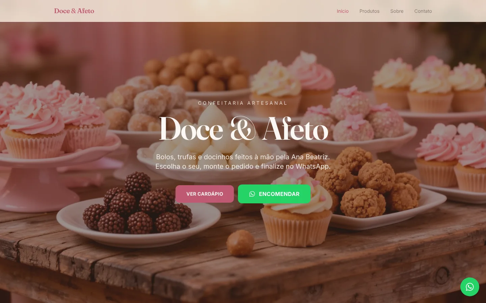
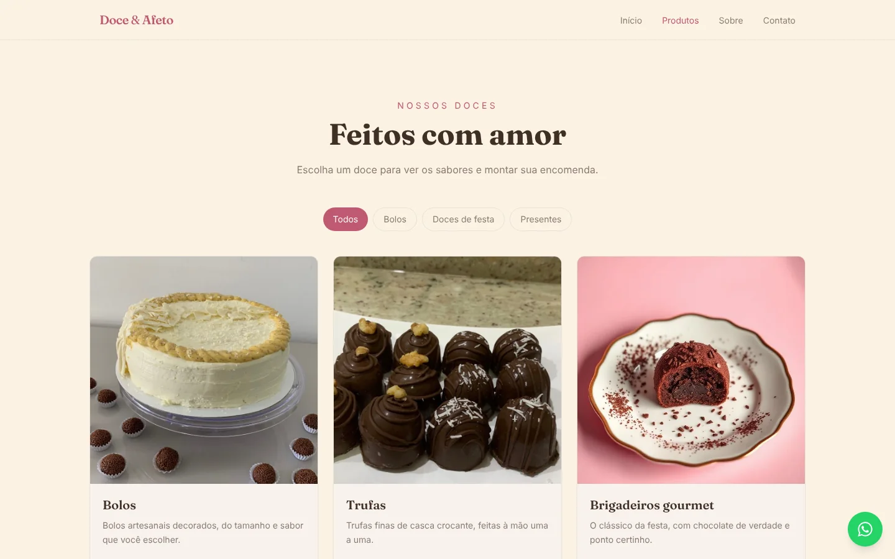
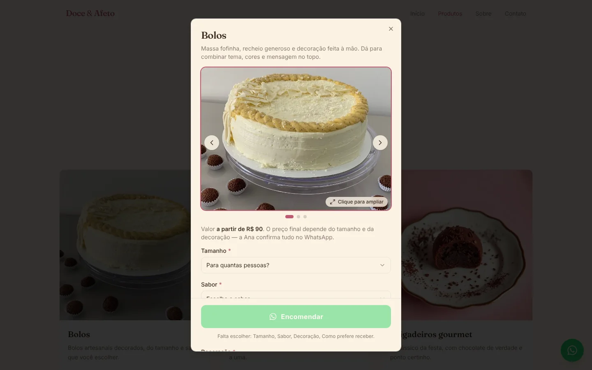
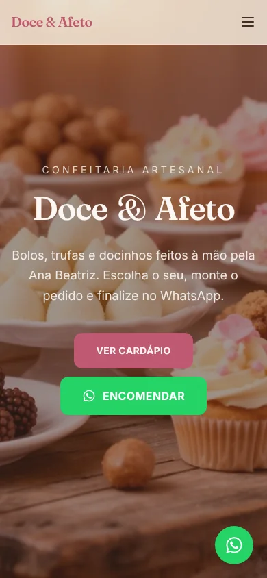

<div align="center">

# Doce & Afeto

Site-vitrine da confeitaria da **Ana Beatriz**. A pessoa navega pelo cardápio, monta a
encomenda (quantidade, sabor, personalização) e finaliza conversando com a Ana no WhatsApp.

**[Ver o site no ar](https://doce-e-afeto.vercel.app/)**




</div>

## Sobre o projeto

Projeto para uma cliente real: a Ana Beatriz faz bolos, trufas e doces de festa e recebia todas as encomendas
por mensagem, respondendo as mesmas perguntas (tamanho, sabor, quantidade, entrega) uma por uma.

**A solução:** um site que apresenta o trabalho dela e faz essas perguntas antes. Cada produto tem o seu formulário,
e o botão "Encomendar" abre o WhatsApp com a mensagem já escrita e organizada. Não há carrinho, login nem
pagamento: a venda continua acontecendo na conversa, do jeito que ela já trabalhava.

## Telas

| Cardápio | Montando a encomenda |
|---|---|
|  |  |

<p align="center"></p>

## Rodando na sua máquina

Precisa do [Node.js](https://nodejs.org) instalado (versão 18 ou mais nova).

```bash
npm install     # instala as dependências (só na primeira vez)
npm run dev     # abre em http://localhost:8080
```

Outros comandos:

```bash
npm run build   # gera a versão final na pasta dist/
npm run test    # roda os testes
npm run lint    # verifica o código
```

## Os 2 arquivos que você vai querer editar

### 1. `src/config/loja.ts` — contato e redes

Número do WhatsApp, Instagram, TikTok, iFood, cidade. **O número precisa ser só dígitos**,
no formato `55` + DDD + número:

```ts
whatsapp: "5511915068813",   // (11) 91234-5678
```

Deixar uma rede como `""` faz ela sumir do site automaticamente.

### 2. `src/data/produtos.ts` — o cardápio

Cada item do array `produtos` vira um card. Dentro de cada produto, `campos` define as
perguntas que aparecem no modal:

| tipo         | vira o quê no site                     | exemplo             |
| ------------ | -------------------------------------- | ------------------- |
| `quantidade` | contador com botões – e +               | 50 brigadeiros      |
| `select`     | lista suspensa, escolha única           | tamanho, sabor      |
| `multi`      | caixinhas, escolha várias (com limite)  | até 3 sabores       |
| `texto`      | campo livre digitado                    | tema da festa, data |

Marcar `obrigatorio: true` faz o botão "Encomendar" ficar apagado até a pessoa preencher.

**Para trocar as fotos:** coloque os arquivos em `src/assets/`, importe no topo de
`produtos.ts` e use no array `imagens`. Imagens acima de ~500 KB deixam o site lento —
vale comprimir antes (o `bolo-3.png` atual tem 1,6 MB).

## Como o botão de encomendar funciona

`src/lib/whatsapp.ts` transforma as escolhas do modal em texto e monta um link `wa.me`.
O WhatsApp abre com a mensagem já escrita, tipo:

```
Oi, Ana! Vim pelo site da Doce & Afeto

Queria encomendar: *Bolos*
- Tamanho: Médio — serve até 20 pessoas
- Sabor: Red velvet
- Quantidade: 2 bolos
- Decoração: Decoração personalizada (tema, cores, topo)
- Como prefere receber: Retirada na Doce e Afeto (Bairro Bom Retiro)
- Observação: Entregar com velinhas decorativas

Consegue me passar o valor e a disponibilidade?
```

Nada é enviado sozinho: a pessoa ainda precisa apertar "enviar" no WhatsApp dela.

## Mapa dos arquivos

```
src/
├── config/loja.ts            contato e redes sociais  <- EDITE
├── data/produtos.ts          cardápio                 <- EDITE
├── lib/whatsapp.ts           monta o link e a mensagem do pedido
├── components/
│   ├── Navbar.tsx            menu fixo do topo
│   ├── Hero.tsx              primeira dobra da home
│   ├── Destaques.tsx         prévia de 3 produtos na home
│   ├── About.tsx             Sobre - "Quem faz"               
│   ├── Products.tsx          grade do cardápio + filtro por categoria
│   ├── ProductDialog.tsx     modal de montar o pedido
│   ├── Contact.tsx           seção de encomendas
│   ├── Footer.tsx            rodapé
│   ├── BotaoWhatsapp.tsx     botão verde reaproveitável
│   ├── BotaoWhatsappFlutuante.tsx  botão flutuante do WhatsApp
│   ├── RedesSociais.tsx      ícones das redes sociais
│   ├── ScrollParaHash.tsx    rola suavemente até âncoras (#sobre, etc.)
│   ├── icons/                ícones SVG personalizados (TikTok, WhatsApp)
│   └── ui/                   componentes shadcn/ui (não precisa mexer)
└── pages/
    ├── Index.tsx             /
    ├── Produtos.tsx          /produtos
    └── NotFound.tsx          404
```

## Publicando

O site é estático — `npm run build` gera a pasta `dist/`, que roda em Vercel, Netlify ou
GitHub Pages.

Como o site usa rotas (`/produtos`), o servidor precisa devolver o `index.html` para
qualquer caminho, senão dá 404 ao recarregar a página. Na Vercel e na Netlify isso é
automático para projetos Vite; no GitHub Pages é preciso configurar.

## Stack

React 18 · TypeScript · Vite · Tailwind CSS · shadcn/ui · React Router · Vitest
